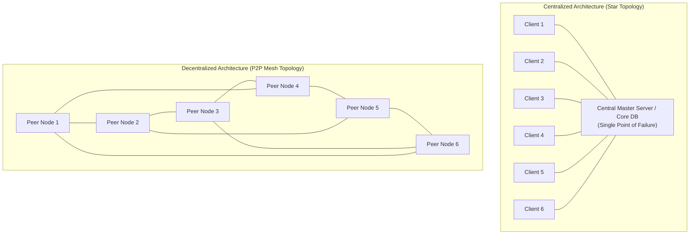
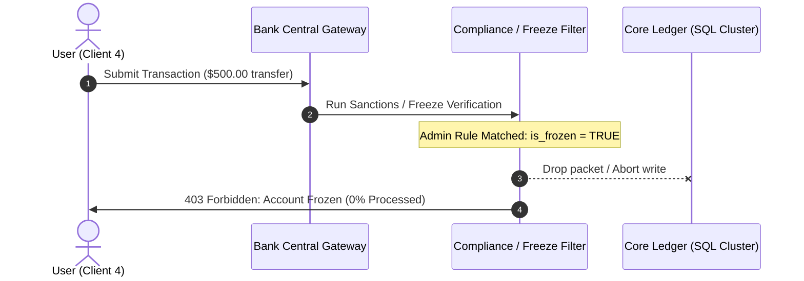
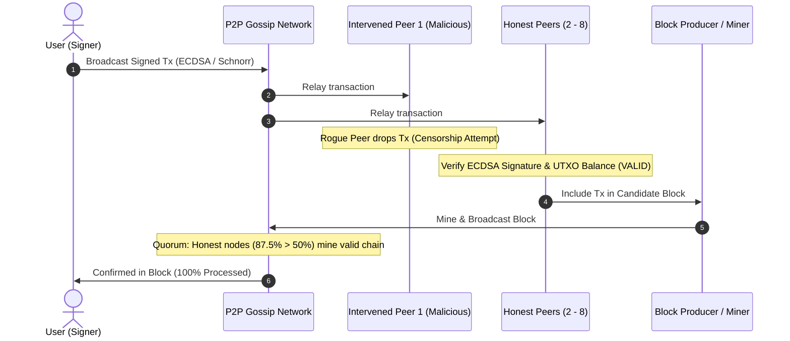

# Centralized vs. Decentralized Architecture: The Intervention & Freeze Simulation Guide

---

## 1. Executive Summary & Core Definitions

In distributed systems and network architecture, the primary distinction between **Centralized** and **Decentralized** systems is how authority, state transitions, and validation rules are distributed.



---

## 2. Mathematical & Structural Divergence Matrix

| Dimension | Centralized Bank Architecture | Decentralized Blockchain (e.g., Bitcoin) |
| :--- | :--- | :--- |
| **Network Topology** | **Star Topology** (Spoke and Hub) | **Full / Partial Mesh Network** (P2P Equivalence) |
| **State Mutation Mechanism** | Single SQL/NoSQL write on master cluster | Append-only Merkle-DAG via distributed consensus |
| **Trust Model** | High trust in a single administrative intermediary | Trustless, governed by cryptographic verification |
| **Intervention / Freeze Action** | **Instantly Blocked (100%)** via 1 root SQL update | **Rejected (0% Censored)**; requires >50% hash rate / stake |
| **Resilience & Fault Tolerance** | High Single Point of Failure (SPOF) | Byzantine Fault Tolerant ($BFT$); resilient to offline/rogue nodes |
| **Auditability** | Private/Permissioned audit logs (mutable) | Public, globally reproducible cryptographic chain |

---

## 3. Step-by-Step Simulation Flow: Freeze Attempt

### Scenario A: Centralized Bank Transaction Flow (Intervention Triggered)



### Scenario B: Decentralized Blockchain Transaction Flow (Censorship Attempt)



---

## 4. Code Comparison: Administrative Pause vs. Protocol Rules

### Centralized Backend Logic (Node.js / Express / SQL)

```javascript
// Centralized server: Single point of censorship authority
async function processBankTransfer(senderAccountId, recipientAccountId, amount) {
  const [account] = await db.query(
    'SELECT is_frozen, balance FROM accounts WHERE id = ? FOR UPDATE',
    [senderAccountId]
  );

  // Administrative freeze condition evaluated unilaterally
  if (account.is_frozen) {
    throw new Error('403 Forbidden: Transaction rejected by administrative freeze order.');
  }

  if (account.balance < amount) {
    throw new Error('400 Bad Request: Insufficient balance.');
  }

  // Unilateral state update
  await db.query('UPDATE accounts SET balance = balance - ? WHERE id = ?', [amount, senderAccountId]);
  await db.query('UPDATE accounts SET balance = balance + ? WHERE id = ?', [amount, recipientAccountId]);

  return { status: 'SETTLED', processed: '100%' };
}
```

### Decentralized Smart Contract Logic (Solidity)

```solidity
// SPDX-License-Identifier: MIT
pragma solidity ^0.8.20;

contract SovereignToken {
    mapping(address => uint256) public balances;
    
    event Transfer(address indexed from, address indexed to, uint256 value);

    // Autonomous rule: No admin can inject a freeze override
    function transfer(address recipient, uint256 amount) public returns (bool) {
        require(recipient != address(0), "Invalid recipient address");
        require(balances[msg.sender] >= amount, "Insufficient UTXO / balance");

        // Mathematical state transition
        balances[msg.sender] -= amount;
        balances[recipient] += amount;

        emit Transfer(msg.sender, recipient, amount);
        return true;
    }
}
```

---

## 5. Mathematical Proof of Censorship Resistance (Nakamoto Consensus)

In Nakamoto consensus, the probability $P$ that an attacker or intervening coalition with hashrate fraction $q$ (where $p = 1 - q$ is the honest hashrate and $p > q$) can maintain a censoring fork follows a Poisson distribution:

$$P = \sum_{k=0}^{\infty} \frac{\lambda^k e^{-\lambda}}{k!} \left( \frac{q}{p} \right)^{\max(z - k, 0)}$$

Where:
- $z$ is the number of confirmations.
- $\lambda = z \cdot \frac{q}{p}$.

As confirmations $z$ increase, if the honest network retains $p > 0.50$ (in our simulation, $87.5\%$ honest), the probability of censorship succeeding asymptotically approaches **$0$**.

---

## 6. Offline Learning & Asset Reference Guide

- **Live Local Simulator**: Open [`index.html`](file:///c:/Users/a/Desktop/project%20folder/blockchain/index.html) in your browser to run both scenarios interactively.
- **Save Diagram Locally**: Right-click the diagram in the web app or browser to save the high-resolution network visual card.
